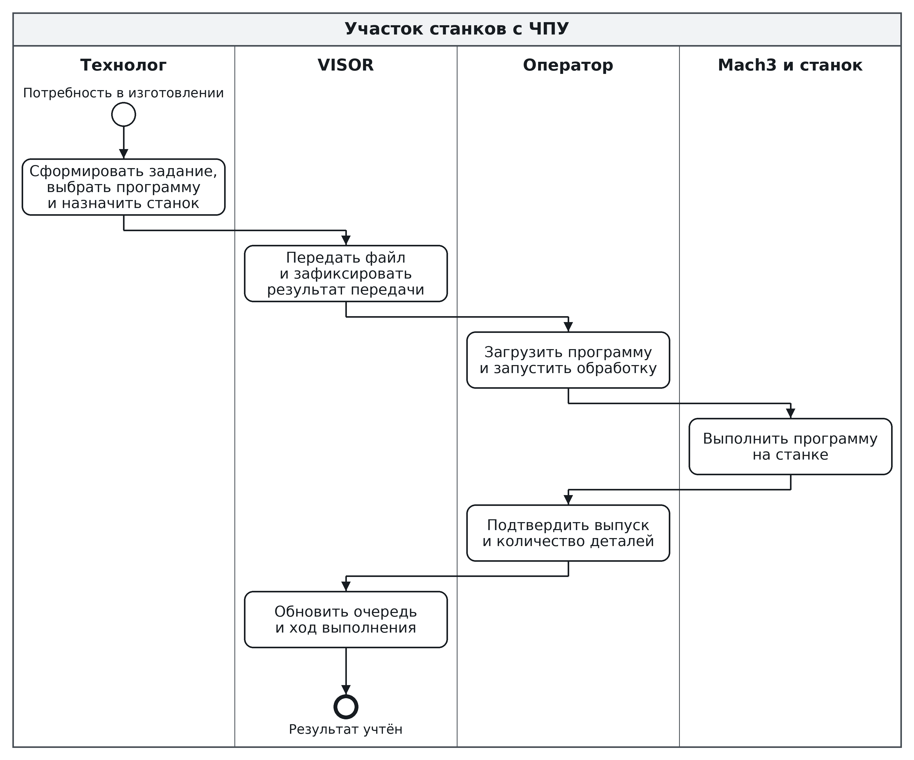

# Введение

# 1. Исследовательский раздел

## 1.1 Характеристика предметной области и объекта автоматизации

В настоящей работе рассматривается информационное обеспечение участка механообработки с применением станков с числовым программным управлением (ЧПУ). Разработка ориентирована на использование на производственных предприятиях атомной промышленности. Для организации работы участка необходимо знать, какие детали и в каком количестве требуется изготовить, какие управляющие программы применяются для их обработки и как выполняются производственные задания.

Состав изделия определяет, какие детали необходимы для его изготовления. Производственное задание устанавливает перечень деталей к изготовлению и их плановое количество. Для обработки детали на станке используется управляющая программа — файл с командами, записанными на языке G-кода. В зависимости от технологического процесса для одной детали могут применяться несколько управляющих программ, соответствующих разным операциям. Связь задания с деталью и её управляющими программами позволяет определить, какие файлы нужны для выполнения конкретного задания.

На рассматриваемом участке эксплуатируются шесть самосборных станков с ЧПУ. Управляющие компьютеры работают под управлением Windows XP. Программа Mach3 интерпретирует команды управляющей программы и через физический параллельный порт (LPT) передаёт электронике станка сигналы шага и направления (STEP/DIR) для управления перемещением осей.

Основным пользователем проектируемой информационной системы является технолог. Для организации работы участка ему необходимы сведения о составе изделий, управляющих программах, загрузке станков и ходе выполнения заданий. Оператор получает управляющую программу для назначенной к изготовлению детали, загружает её в Mach3 и запускает обработку на рабочем месте станка. Ход выполнения задания можно оценить по фактически изготовленному количеству деталей относительно плана. Состояние станка характеризует работу оборудования в конкретный момент.

Объектом автоматизации являются процессы ведения производственных заданий, хранения и передачи управляющих программ, а также получения сведений о состоянии станков и ходе изготовления деталей. Проектируемая информационная система VISOR должна обеспечить централизованную работу с этими данными. Формирование сигналов STEP/DIR и выполнение управляющих программ остаются функциями Mach3. Получение сведений о состоянии оборудования должно осуществляться с такой нагрузкой на управляющий компьютер, при которой сохраняется штатная работа станка.

В настоящее время управляющие программы передаются на каждый станок отдельно с помощью USB-накопителя. Сведения о состоянии станков и количестве изготовленных изделий технолог учитывает по памяти, иногда фиксируя их в свободной форме на бумаге. Этот порядок работы и целевая модель процесса рассматриваются в подразделе 1.2.

## 1.2 Анализ существующего процесса и построение целевой модели

**Существующий процесс (AS-IS)**

Рассматриваемый процесс начинается с передачи готовой управляющей программы на рабочее место станка. Файл G-кода записывают на USB-накопитель и доставляют к каждому станку, для которого он предназначен. Оператор открывает полученную программу в Mach3 и запускает обработку с управляющего компьютера. Порядок подготовки и согласования программ до их передачи требует уточнения.

При обновлении управляющей программы файл требуется повторно передать на каждое рабочее место, где его планируется использовать. Если на рабочем месте сохраняются файлы разных редакций, возникает риск выбора устаревшей программы. Порядок контроля редакций и регистрации передач требует отдельного уточнения.

Технолог учитывает состояние станков и количество изготовленных изделий по памяти, иногда фиксируя сведения на бумаге в свободной форме. Постоянная система учёта отсутствует. Для оценки хода выполнения задания имеющиеся сведения нужно вручную сопоставлять с планом. Разрозненность записей затрудняет восстановление связи между результатом обработки, станком и использованным файлом.

Общий файловый ресурс Samba подключался на одном из управляющих компьютеров в рамках подготовки пилотной среды. Этот ресурс может использоваться для проверки сетевого обмена управляющими программами. В повседневном процессе файлы доставляются на USB-накопителе.

**Целевая модель процесса (TO-BE)**

В целевом процессе производственное задание связывается с изделием, деталью, назначенным станком и конкретной редакцией управляющей программы. На рисунке 1.1 представлен основной сценарий в нотации BPMN. Он охватывает путь от формирования задания до регистрации результата обработки и показывает действия технолога, системы VISOR, оператора и оборудования.

Рисунок 1.1 — Целевая модель выполнения производственного задания

Технолог оформляет задание, указывает деталь и плановое количество, выбирает управляющую программу из централизованного хранилища и назначает станок. Задание включается в производственную очередь. При выдаче программы VISOR размещает выбранный файл на сетевом ресурсе, доступном рабочему месту станка, и сохраняет результат передачи. В случае сбоя система сообщает технологу о незавершённой передаче, чтобы он мог повторить её после восстановления доступа.

После успешной передачи оператор открывает файл в Mach3 и запускает обработку на рабочем месте. Доставка файла, его открытие в Mach3 и запуск программы являются отдельными событиями. Mach3 выполняет управляющую программу и формирует сигналы STEP/DIR в существующем контуре управления. Уже запущенная обработка должна продолжаться при недоступности сети или VISOR.

В представленном сценарии оператор подтверждает количество изготовленных деталей, после чего VISOR обновляет состояние задания и сведения о ходе его выполнения. Подтверждённое количество сопоставляется с плановым. Порядок подтверждения выпуска, включая распределение полномочий между сотрудниками, подлежит уточнению при проектировании.

Получение сведений о состоянии станка предусмотрено параллельно с выполнением задания. В проекте предполагается использовать лёгкий программный агент, если чтение состояний Mach3 подтвердится на оборудовании и сохранится штатная работа станка. Для полученных сведений следует указывать время последнего обновления. При потере связи на панели отображается отсутствие актуальных данных. Подтверждённое количество изготовленных деталей учитывается независимо от доступности мониторинга.

Входными данными процесса служат состав изделия, перечень станков, файлы управляющих программ и сведения о плановом количестве деталей. В ходе выполнения к ним добавляются результаты передачи, доступные сведения о состоянии оборудования и подтверждённые данные о выпуске. На выходе технолог получает актуальную очередь заданий, сведения о переданных программах и ходе изготовления, а оператор — файл управляющей программы для назначенного станка. При сравнении существующих решений в подразделе 1.3 учитываются поддержка этих функций и применимость к оборудованию рассматриваемого участка.

## 1.3 Сравнительный анализ программных решений

## 1.4 Постановка задачи и требования к информационной системе

# 2. Проектный раздел

## 2.1 Функциональная модель и роли пользователей

## 2.2 Архитектура системы и взаимодействие с рабочими местами станков

## 2.3 Информационное обеспечение и логическая модель базы данных

## 2.4 Алгоритмы формирования очереди, выдачи программы и учёта выполнения

# 3. Технологический раздел

## 3.1 Выбор и обоснование средств разработки

## 3.2 Реализация базы данных и хранения версий управляющих программ

## 3.3 Реализация функций системы и пользовательского интерфейса

## 3.4 Развёртывание прототипа на испытательном стенде

## 3.5 Функциональное тестирование и результаты испытаний

# 4. Экономический раздел

## 4.1 Организация и календарное планирование разработки

## 4.2 Расчёт стоимости разработки информационной системы

# Заключение и приложения

## Приложения

### А — техническое задание по ГОСТ 34.602-2020

### Б — крупноформатные диаграммы процесса и модели данных

### В — программа и протокол испытаний